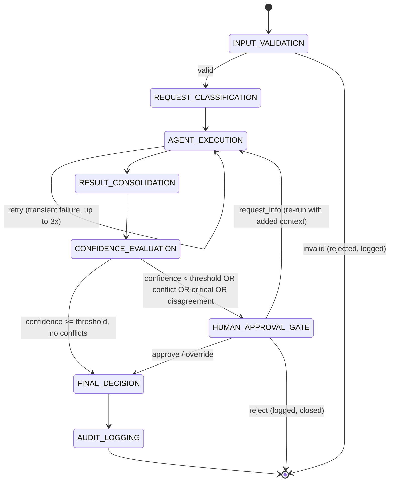
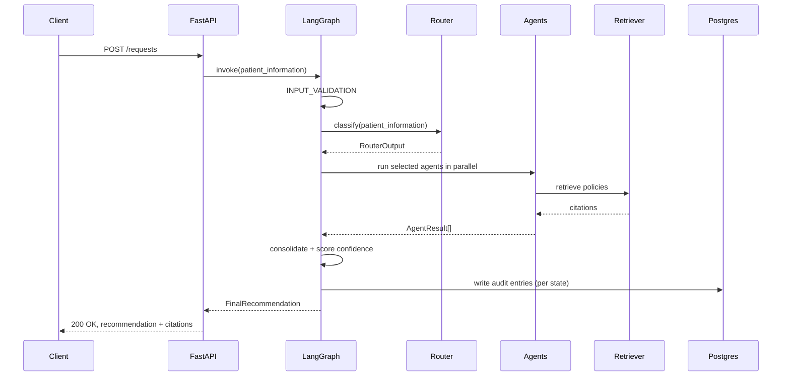
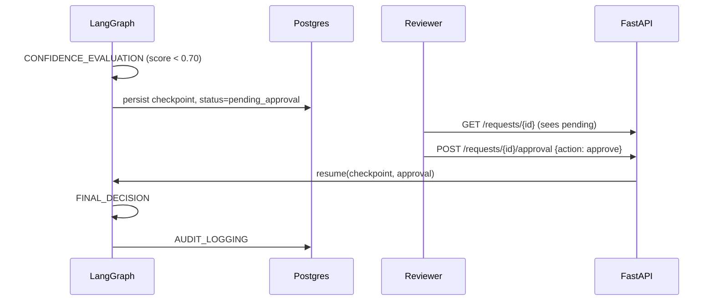

# Hospital Resource Allocation System — Implementation Plan for Claude Code

This plan turns the brief into a sequence of self-contained build sessions. Each phase has a
clear scope, a done-state you can verify, and a ready-to-paste kickoff prompt. Feed Claude Code
one phase at a time — don't paste the whole plan into one session. Claude Code (and any coding
agent) does better with a bounded task and a way to check its own work than with an open-ended
spec.

> **Data-handling constraint (applies to every phase):** this system stores *operational*
> patient data only — synthetic patient IDs, acuity level, diagnosis category, isolation/
> monitoring flags. It never stores or displays SSN, Aadhaar, PAN, passport numbers, driver's
> license numbers, insurance/payer IDs, or full medical records. Seed data and fixtures must be
> synthetic. This is narrower than typical HIPAA-covered EHR data on purpose — the allocation
> system only needs enough clinical signal to route beds/staff, not a full chart.

---

## 0. How to run this with Claude Code

1. Create a `CLAUDE.md` at the repo root (Phase 0 does this) that pins: the state model, the
   naming conventions, the folder layout, and this constraint list. Claude Code reads this file
   automatically at the start of every session, so architectural decisions don't drift between
   sessions.
2. Work phase by phase. At the start of a session, tell Claude Code which phase to build and
   paste that phase's "Kickoff prompt." At the end, run that phase's "Definition of done" checks
   yourself before moving on.
3. Keep a `PROGRESS.md` where Claude Code appends a one-paragraph summary after each phase —
   this is cheaper than re-reading the whole codebase for context in the next session.
4. If a phase turns out too big for one session, stop at a natural sub-boundary (e.g., "models +
   migrations" before "seed data") and commit before continuing.

---

## 1. Architecture Overview

```
                         ┌────────────────────────┐
                         │   FastAPI REST Layer    │
                         │ (requests, approvals,   │
                         │  audit, policy search)  │
                         └───────────┬─────────────┘
                                     │
                         ┌───────────▼─────────────┐
                         │   LangGraph Orchestrator │
                         │  (the 8-state workflow)  │
                         └───────────┬─────────────┘
                 ┌───────────────────┼───────────────────┐
                 │                   │                   │
        ┌────────▼───────┐ ┌─────────▼────────┐ ┌────────▼────────┐
        │  Bed Allocation │ │ Staff Allocation │ │ Emergency Routing│
        │      Agent      │ │      Agent       │ │      Agent       │
        └────────┬────────┘ └─────────┬────────┘ └────────┬────────┘
                 │                    │                    │
                 └─────────► RAG Retrieval Layer ◄─────────┘
                              (Chroma + embeddings)
                                     │
                         ┌───────────▼─────────────┐
                         │  PostgreSQL (state,      │
                         │  beds, staff, audit log) │
                         └──────────────────────────┘
```

Design choices worth stating up front, since they shape every later phase:

- **LangGraph owns control flow, not the agents.** Agents are pure functions of
  `(patient_info, retrieved_policies, resource_snapshot) -> AgentResult`. They don't call each
  other or know about the graph. This keeps them unit-testable in isolation.
- **Every agent output is required to carry ≥1 citation.** If retrieval returns nothing relevant,
  the agent must return a low-confidence result and flag `policy_grounding: false` rather than
  reasoning ungrounded — this is what makes the "100% policy compliance" target enforceable in
  code rather than aspirational.
- **The graph is resumable.** Human approval is implemented as a LangGraph interrupt, not a
  separate service, so pausing/resuming is a first-class state transition with its own audit
  entry, not a side workflow bolted on.

---

## 2. Repository Structure

```
hospital-allocation-system/
├── CLAUDE.md                      # context file for coding agents
├── PROGRESS.md                    # running log, one entry per phase
├── docker-compose.yml
├── docker-compose.test.yml
├── Dockerfile
├── pyproject.toml
├── .env.example
├── alembic/
│   └── versions/
├── data/
│   └── policies/                  # seed policy documents (markdown/pdf)
│       ├── bed_allocation_policy.md
│       ├── staffing_policy.md
│       ├── emergency_protocols.md
│       ├── infection_control_standards.md
│       └── compliance_rules.md
├── app/
│   ├── main.py
│   ├── config.py
│   ├── api/
│   │   ├── requests.py
│   │   ├── approvals.py
│   │   ├── audit.py
│   │   ├── policy.py
│   │   └── agents_status.py
│   ├── models/
│   │   ├── domain.py               # Pydantic: PatientInfo, WorkflowState, AgentResult...
│   │   └── orm.py                  # SQLAlchemy tables
│   ├── graph/
│   │   ├── state.py                 # WorkflowState TypedDict for LangGraph
│   │   ├── nodes/
│   │   │   ├── input_validation.py
│   │   │   ├── router.py
│   │   │   ├── agent_execution.py
│   │   │   ├── consolidation.py
│   │   │   ├── confidence_eval.py
│   │   │   ├── human_approval.py
│   │   │   ├── final_decision.py
│   │   │   └── audit_logging.py
│   │   └── build_graph.py
│   ├── agents/
│   │   ├── bed_allocation.py
│   │   ├── staff_allocation.py
│   │   └── emergency_routing.py
│   ├── rag/
│   │   ├── ingest.py
│   │   ├── chunking.py
│   │   ├── embeddings.py
│   │   ├── vector_store.py
│   │   └── retriever.py
│   ├── services/
│   │   ├── capacity.py              # bed/staff availability lookups
│   │   ├── audit.py
│   │   └── notifications.py
│   └── observability/
│       ├── logging.py
│       └── tracing.py
├── deploy/
│   └── k8s/
│       ├── deployment.yaml
│       ├── service.yaml
│       ├── configmap.yaml
│       ├── secret.yaml
│       └── hpa.yaml
├── tests/
│   ├── unit/
│   ├── integration/
│   └── e2e/
│       └── test_demo_scenarios.py   # the 3 scenarios below, as regression tests
└── frontend/
    └── demo/                        # the standalone showcase UI (see companion file)
```

---

## 3. Core Data Model

These are the shapes every phase builds against. Define them once in Phase 1 and don't let
later phases redefine fields ad hoc.

```python
# app/models/domain.py  (Pydantic)

class PatientInfo(BaseModel):
    patient_ref: str            # synthetic id, e.g. "PT-2026-00931" — never a real MRN/SSN
    age: int
    presenting_complaint: str
    diagnosis_category: str     # e.g. "acute_mi", "pneumonia_respiratory_distress"
    severity: Literal["critical", "high", "moderate", "minor"]
    requires_isolation: bool
    requires_monitoring_level: Literal["none", "standard", "icu"]
    arrival_mode: Literal["walk_in", "ambulance", "transfer", "mass_casualty"]

class RouterOutput(BaseModel):
    request_type: Literal["bed_allocation", "staff_allocation", "emergency_routing", "combination"]
    selected_agents: list[str]
    routing_reasoning: str
    confidence_score: float

class PolicyCitation(BaseModel):
    citation_id: str
    policy_name: str
    section: str
    excerpt: str                # short, paraphrased — never the full source paragraph
    similarity_score: float

class AgentResult(BaseModel):
    agent_name: str
    decision: dict               # shape varies per agent, validated per-agent subtype
    reasoning: str
    confidence_score: float
    citations: list[PolicyCitation]
    policy_grounded: bool

class ApprovalRecord(BaseModel):
    reviewer_id: str
    action: Literal["approve", "reject", "override", "request_info"]
    notes: str | None
    decided_at: datetime

class AuditEntry(BaseModel):
    request_id: str
    state: str                   # one of the 8 LangGraph states
    timestamp: datetime
    input_snapshot: dict
    output_snapshot: dict
    actor: Literal["system", "human"]

class WorkflowState(TypedDict):
    request_id: str
    patient_information: PatientInfo
    request_type: str | None
    workflow_status: str
    active_agents: list[str]
    agent_results: list[AgentResult]
    retrieved_policies: list[PolicyCitation]
    confidence_scores: dict[str, float]
    approval_status: str | None
    final_recommendation: dict | None
    audit_trail: list[AuditEntry]
    retry_count: int
```

---

## 4. Database Schema (PostgreSQL)

| Table | Key columns |
|---|---|
| `requests` | `id`, `patient_ref`, `request_type`, `status`, `created_at`, `closed_at` |
| `patients` | `patient_ref` (PK, synthetic), `age`, `diagnosis_category`, `severity`, `requires_isolation`, `requires_monitoring_level` — no direct-identifier columns |
| `beds` | `id`, `bed_type` (`icu`/`general`/`isolation`), `status`, `ward`, `floor` |
| `staff` | `id`, `role`, `specialty`, `shift`, `status` |
| `agent_results` | `id`, `request_id` (FK), `agent_name`, `decision_json`, `confidence_score`, `policy_grounded` |
| `policy_citations` | `id`, `agent_result_id` (FK), `policy_name`, `section`, `excerpt`, `similarity_score` |
| `approvals` | `id`, `request_id` (FK), `reviewer_id`, `action`, `notes`, `decided_at` |
| `audit_log` | `id`, `request_id` (FK), `state`, `timestamp`, `input_snapshot_json`, `output_snapshot_json`, `actor` — append-only, no update/delete grants |
| `policy_documents` | `id`, `name`, `source_path`, `version`, `effective_date` |
| `policy_chunks` | `id`, `policy_document_id` (FK), `chunk_text`, `embedding` (pgvector or reference to Chroma id), `chunk_index` |

`audit_log` should be append-only at the DB-role level (`INSERT` only, no `UPDATE`/`DELETE` grant)
so the audit trail can't be silently edited later.

---

## 5. LangGraph Workflow



Notes for implementation:

- `AGENT_EXECUTION` fans out to 1–3 agent nodes in parallel (LangGraph's parallel branch support)
  based on `selected_agents` from the router, then joins before `RESULT_CONSOLIDATION`.
- Retries wrap only `AGENT_EXECUTION` (LLM/tool calls), with exponential backoff (attempt 1, 2, 3
  over ~30s as in the brief). After 3 failures, fall back to a conservative default (General Ward
  / no staff reassignment) and force a human-approval routing regardless of confidence.
- Use a Postgres-backed LangGraph checkpointer so an interrupted graph (e.g., process restart
  during `HUMAN_APPROVAL_GATE`) resumes from the same state rather than re-running from scratch.

### Sequence diagram — single request, auto-approved path



### Sequence diagram — low-confidence, human-in-the-loop path



---

## 6. RAG Policy Engine

- **Ingestion**: markdown/PDF policy docs under `data/policies/`, one file per policy domain
  (bed allocation, staffing, emergency protocols, infection control, compliance).
- **Chunking**: recursive character splitter, ~500 tokens with ~50-token overlap; each chunk
  keeps metadata `{policy_name, section_heading, effective_date}` so citations are traceable
  back to a real section, not just a document.
- **Embeddings**: Azure OpenAI / OpenAI `text-embedding-3-small` by default; keep the embedding
  call behind an interface (`app/rag/embeddings.py`) so a local `sentence-transformers` model can
  swap in for offline dev/tests.
- **Vector store**: Chroma, persistent client, one collection, metadata-filtered per agent domain
  (`domain: bed | staffing | emergency | compliance`) so each agent only retrieves from its
  relevant policy subset.
- **Retrieval**: top-k (default k=4) similarity search filtered by domain; return
  `PolicyCitation` objects, never raw chunk text longer than ~2 sentences in the excerpt field.
- **Grounding rule**: if the top result's similarity score is below a floor (e.g., 0.55), the
  agent must lower its confidence score and set `policy_grounded: false` rather than reason from
  the LLM's general knowledge.

**Definition of done:** `POST /policy/search {"query": "...", "domain": "bed"}` returns ranked
chunks with citation metadata; a retrieval unit test confirms a known query hits the expected
policy section.

---

## 7. Router and Agents

### Router
Implement as a single structured-output LLM call (JSON schema / function-calling) returning the
`RouterOutput` shape. Handle multi-intent by allowing `selected_agents` to contain more than one
agent and `request_type: "combination"`. Cover both in unit tests with fixture requests.

### Agents (Bed / Staff / Emergency)
Each agent is a LangChain runnable with three inputs — `patient_information`,
`retrieved_policies`, `resource_snapshot` (current bed/staff availability, pulled via a tool call
to `app/services/capacity.py`) — and one structured output, `AgentResult`. Keep the LLM prompt for
each agent narrow and domain-specific (see prompt skeletons below) so reasoning stays grounded in
the retrieved citations rather than general medical knowledge.

```
Bed Allocation Agent prompt skeleton:
  You allocate hospital beds. Given patient severity, isolation needs, monitoring needs,
  and current bed availability, recommend one of: ICU, General Ward, Isolation Room.
  Cite only the provided policy excerpts. If no excerpt supports a clear decision,
  say so and lower your confidence.

Staff Allocation Agent prompt skeleton:
  You assign staff. Given specialty needs, current shift staffing, and staffing-ratio
  policy excerpts, recommend a staff assignment and validate it against ratio rules.

Emergency Routing Agent prompt skeleton:
  You triage incoming emergencies. Given severity, hospital load, and specialist
  availability, decide: Accept, Transfer to Regional Hospital, or Divert to Urgent Care.
```

**Definition of done:** each agent has unit tests (mocked LLM + mocked capacity data) covering a
clear-cut case and an ambiguous/low-confidence case.

---

## 8. Consolidation, Confidence, and Human Approval

- **Consolidation**: for `combination` requests, merge agent outputs into one recommendation;
  if two agents' decisions conflict (e.g., bed agent says ICU but staff agent can't confirm ICU
  nursing coverage), flag `conflict: true` and force human review regardless of individual
  confidence scores.
- **Confidence aggregation**: default to the *minimum* across active agents' confidence scores,
  not the average — a single low-confidence agent should be able to pull the whole decision
  below the approval threshold. Make the aggregation function pluggable and document the
  default in `app/graph/nodes/confidence_eval.py`.
- **Threshold**: `HUMAN_APPROVAL_THRESHOLD = 0.70`, configurable via settings — matches the
  brief's flowchart.
- **Human approval gate**: reviewer actions are `approve`, `reject`, `override`,
  `request_info`. `override` lets the reviewer substitute their own decision, which is stored
  alongside (not instead of) the original agent recommendation for audit purposes.

---

## 9. Audit Framework

Every state transition writes one `AuditEntry` — not just the final decision. Store input and
output snapshots per state so a reviewer can reconstruct exactly what the system saw and
concluded at each step. Pair this with structured JSON logging (`structlog`) and LangSmith
tracing so the same request can be inspected in logs, in the audit table, and in a LangSmith
trace.

**Definition of done:** `GET /audit/{request_id}` returns a complete, timestamped list covering
all 8 states for a given request, including every policy citation used.

---

## 10. REST API Surface

| Method | Path | Purpose |
|---|---|---|
| `POST` | `/requests` | Create a request; kicks off the LangGraph run |
| `GET` | `/requests/{id}` | Current workflow status |
| `GET` | `/requests/{id}/recommendation` | Final or in-progress recommendation + citations |
| `POST` | `/requests/{id}/approval` | Submit reviewer action (approve/reject/override/request_info) |
| `GET` | `/audit/{id}` | Full audit trail for a request |
| `POST` | `/policy/search` | Ad-hoc policy search (debugging / transparency tool) |
| `GET` | `/agents/status` | Health/load per agent (for the monitoring UI) |

Auth is out of scope for the first pass — stub an API-key header check and flag it clearly as a
pre-production TODO in `CLAUDE.md`.

---

## 11. Testing Strategy

- **Unit**: router classification fixtures, each agent in isolation, confidence aggregation
  function, retrieval ranking.
- **Integration**: full graph run against a test Postgres + Chroma (via
  `docker-compose.test.yml`), including a forced-failure test that exercises the retry →
  fallback path.
- **End-to-end regression**: encode the three demo scenarios below as `tests/e2e/
  test_demo_scenarios.py` so the exact known-good outcomes stay pinned as the system evolves.

### Demo scenarios to encode as regression tests

1. **Critical cardiac case** — acute MI, requires ICU monitoring → expect ICU bed
   recommendation, confidence ≥ 0.85, citations from bed-allocation and emergency-protocol
   policies, auto-approved (no human gate).
2. **High-acuity isolation case** — infectious, requires isolation + respiratory support →
   expect isolation room + specialist staff assignment, confidence in the high-0.80s, citations
   from infection-control and staffing policies.
3. **Mass-casualty burst** — 8 simultaneous patients → expect all 8 processed concurrently,
   a mix of ICU / general-ward / transfer / divert outcomes based on severity and capacity, and
   a complete audit entry for every one of the 8 within the same run.

---

## 12. Observability and Deployment

- Structured logging (`structlog`) with one log line per state transition, correlated by
  `request_id`.
- LangSmith tracing enabled via env vars in non-local environments.
- `Dockerfile`: multi-stage (build deps, then slim runtime image).
- `docker-compose.yml`: `api`, `postgres`, `chroma` services for local dev.
- `deploy/k8s/`: `Deployment`, `Service`, `ConfigMap` (non-secret settings), `Secret` (API keys,
  DB creds — templated, never committed with real values), `HorizontalPodAutoscaler` keyed on
  CPU/latency.

---

## 13. Phase Checklist (paste one at a time into Claude Code)

- [ ] **Phase 0 — Bootstrap.** *Kickoff:* "Set up the repo structure from Section 2, a FastAPI
  skeleton with a `/health` endpoint, Docker Compose with Postgres + Chroma, and a `CLAUDE.md`
  capturing the data model and data-handling constraint from this plan." *Done when:* `docker
  compose up` runs and `/health` returns 200.
- [ ] **Phase 1 — Models & schema.** *Kickoff:* "Implement the Pydantic models from Section 3 and
  the SQLAlchemy tables + Alembic migration from Section 4. Add a seed script with synthetic bed/
  staff/policy-document rows." *Done when:* migrations apply cleanly and the seed script runs.
- [ ] **Phase 2 — RAG engine.** *Kickoff:* "Implement ingestion, chunking, embeddings, and
  retrieval per Section 6, using the seed policy docs in `data/policies/`." *Done when:*
  `POST /policy/search` returns correct, cited results for a known query.
- [ ] **Phase 3 — Router.** *Done when:* router fixtures classify correctly, including a
  combination-request fixture.
- [ ] **Phase 4 — Agents.** *Done when:* each agent passes its unit tests with mocked LLM/DB.
- [ ] **Phase 5 — LangGraph orchestration.** *Done when:* an end-to-end graph run on a fixture
  request produces a `FinalDecision`, and a forced-failure test exercises retry → fallback.
- [ ] **Phase 6 — Consolidation & confidence.** *Done when:* a conflicting-agents fixture
  correctly forces human review.
- [ ] **Phase 7 — Human approval.** *Done when:* a low-confidence run pauses, and each of the
  four reviewer actions resumes the graph correctly.
- [ ] **Phase 8 — Audit.** *Done when:* `GET /audit/{id}` shows all 8 states for a completed run.
- [ ] **Phase 9 — API layer.** *Done when:* all endpoints in Section 10 are live with OpenAPI
  docs.
- [ ] **Phase 10 — Tests.** *Done when:* the three demo scenarios pass as e2e regression tests.
- [ ] **Phase 11 — Observability & deployment.** *Done when:* `docker build` succeeds and
  k8s manifests apply to a local cluster (kind/minikube) without errors.
- [ ] **Phase 12 — Wire up the showcase UI.** *Done when:* the companion demo UI's mock fetch
  layer is swapped for the real endpoints from Section 10 and the three scenarios run against
  the live backend.
